<!-- header -->

  

  

 

<!-- mascot -->

  

<!-- about -->

  

 

## 🛠️ tech I reach for

  

  
  
  
  
  
  
  

 

## 📊 by the numbers

  
  &nbsp;
  

  <picture>
    <source media="(prefers-color-scheme: dark)" srcset="https://raw.githubusercontent.com/APAKSHAT/APAKSHAT/output/github-snake-dark.svg"/>
    <source media="(prefers-color-scheme: light)" srcset="https://raw.githubusercontent.com/APAKSHAT/APAKSHAT/output/github-snake.svg"/>
    
  </picture>

<!-- footer -->

  

